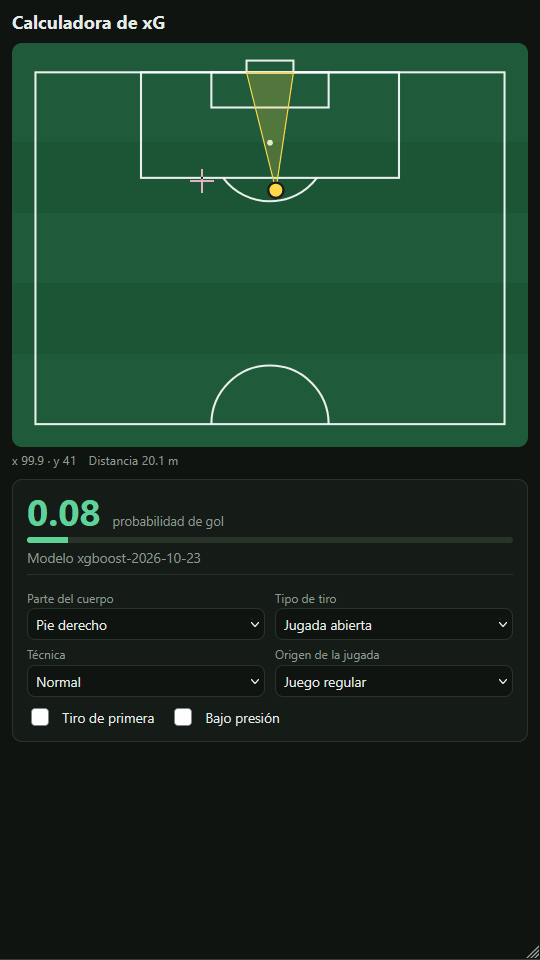
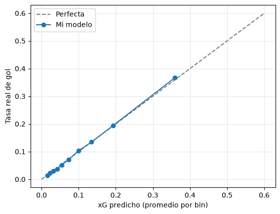

# xG API: expected goals model, served end to end


An expected goals (xG) model trained on open event data, deployed as a containerized API with an interactive pitch UI. Click where a shot is taken, pick the conditions, and get the probability of scoring.

**Live demo:** https://xg-api.onrender.com/
**API docs:** https://xg-api.onrender.com/docs

> Runs on Render's free tier: if it has been idle, the first load takes ~30 s to wake up.



## What is xG?

Expected goals is the probability that a shot becomes a goal, given the circumstances of the shot. It lets analysts judge the quality of chances rather than just counting goals, which are rare and noisy.

## What's in this repo

| Piece | What it does |
|---|---|
| `src/xg/data.py` | Downloads shot events from StatsBomb Open Data |
| `src/xg/features.py` | Distance and goal-visibility angle from raw coordinates |
| `src/xg/train.py` | Cross-validated comparison of models, saves the best one |
| `src/xg/api.py` | FastAPI service with validated inputs, single and batch prediction |
| `src/xg/static/index.html` | Half-pitch UI that calls the API |
| `tests/` | API tests (validation, sanity checks, batch consistency) |
| `Dockerfile` + `.github/workflows/ci.yml` | Container image, lint, tests and a smoke test on every push |

## Model

- **Data:** ~99.7k shots from [LISTA AQUÍ LAS COMPETICIONES] (StatsBomb Open Data). Penalties and shootout kicks are excluded.
- **Features:** distance to goal, visible goal angle, body part, shot type, technique, play pattern, first-time shot, under pressure.
- **Leakage guard:** StatsBomb's own `shot_statsbomb_xg` is never used as a feature. It is only used afterwards as a reference.
- **Validation:** 5-fold `GroupKFold` grouped by match, so shots from the same match never appear in both train and test.
- **Pipeline:** feature engineering, encoding and model live in a single scikit-learn `Pipeline`, so the API receives raw inputs and training and serving cannot drift apart.

### Results (out-of-fold)

| Model | Log loss | Brier | ROC AUC |
|---|---|---|---|
| Prior (no features) | 0.3307 | 0.0921 | 0.500 |
| Logistic regression, distance + angle | 0.2951 | 0.0840 | 0.737 |
| Logistic regression, all features | 0.2797 | 0.0800 | 0.779 |
| **XGBoost, all features** | **0.2776** | **0.0797** | **0.783** |
| *StatsBomb xG (reference)* | *0.2660* | *0.0753* | *0.805* |

Findings:

- The extra context features (body part, play pattern, pressure...) matter more than the choice of algorithm. XGBoost is only marginally better than logistic regression.
- The model is well calibrated: when it says 0.20, about 20% of those shots are goals.



### Why StatsBomb's xG is better

StatsBomb's model uses the **freeze frame** (positions of the goalkeeper and defenders at the moment of the shot). This model only uses event data, and it was trained on less data. The gap is small, and adding freeze-frame features is the obvious next step.

## Run it

```bash
# install
uv sync

# download data and train (writes models/xg_model.joblib)
uv run python -m xg.data
uv run python -m xg.train

# serve locally
uv run uvicorn xg.api:app --reload      # http://127.0.0.1:8000

# or with Docker
docker build -t xg-api .
docker run --rm -p 8080:8080 xg-api     # http://localhost:8080

# tests
uv run pytest
```

### Example request

```bash
curl -X POST http://localhost:8080/predict \
  -H "Content-Type: application/json" \
  -d '{"x": 108, "y": 40, "shot_body_part": "Right Foot"}'
```

```json
{"xg": 0.31, "model_version": "xgboost-2026-10-19"}
```

Coordinates follow the StatsBomb convention: a 120 x 80 pitch, attacking the goal at `x = 120`. Invalid input (a position off the pitch, an unknown body part) returns a 422.

## Design decisions

- Categorical inputs are strict `Literal` types: a typo returns an error instead of being silently ignored by the encoder.
- The model is loaded once at startup, and each response includes the model version.
- CI runs lint, tests, builds the image and sends a real prediction to the running container before anything is deployed.

## Limitations

- No goalkeeper or defender positions, so shots with identical event data but very different situations get the same xG.
- Trained on a limited set of competitions, so it may not transfer to leagues with a different style or level.
- Free-tier hosting: cold starts, no authentication, no rate limiting.
- Predictions are logged, but drift monitoring is not implemented yet.

## Roadmap

- [ ] Freeze-frame features from StatsBomb 360 data
- [ ] Drift monitoring with Evidently
- [ ] Model registry and scheduled retraining (MLflow)

## Data

Shot data comes from [StatsBomb Open Data](https://github.com/statsbomb/open-data). Please credit StatsBomb if you reuse or publish anything derived from it.
